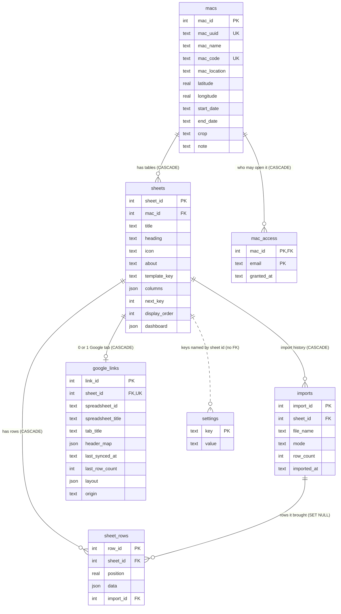

# UKMAC Monitoring: the database

One SQLite file on the computer, `ukmac.db`, made by `src-tauri/src/db.rs` (rusqlite, WAL mode).
Folder on a Mac: `~/Library/Application Support/com.ukmac.monitoring/`.
Schema version: **6** (`PRAGMA user_version`; each entry of `MIGRATIONS` in `db.rs` moves it up by one).
Foreign keys are on, so deleting a parent removes its children (see "What deletes what").

Everything lives in **7 tables**. Everything below `macs` hangs off `sheets`.

## Relationship diagram



In words:

```
macs (a farm)
 ├── mac_access        which Google accounts may see this MAC (email list)
 └── sheets (a table of the farm: Zones, Harvest, Nursery Progress…)
      ├── sheet_rows   the records (cells in one JSON object per row)
      ├── imports      one row per Excel/Google read (file name, mode, how many rows)
      │     └── sheet_rows.import_id points back here, so a read can be undone
      └── google_links 0 or 1: the Google Sheet tab this table mirrors
settings              loose key/value (counters, last Google source, view choices)
```

## Tables

### `macs`: a farm (MAC)
| Column | Meaning |
|---|---|
| `mac_id` | integer id, auto-increment |
| `mac_uuid` | unique id that travels in a `.ukmac` file |
| `mac_name`, `mac_code` | name and short code (e.g. `MAC-001`; code is unique, case-insensitive) |
| `mac_location`, `latitude`, `longitude` | where the farm is (left out of `.ukmac` files) |
| `start_date`, `end_date`, `note` | optional |
| `crop` | `chili` (the only crop in this app) |
| `created_at`, `updated_at` | timestamps |

### `mac_access`: who may open a MAC
Primary key `(mac_id, email)`; index on `email`. The app only shows a signed-in Google account the MACs
listed for it (`src-tauri/src/access.rs`). This is a lock inside the app, not encryption: the `.db` file
is plain.

### `sheets`: a table of a MAC
| Column | Meaning |
|---|---|
| `sheet_id`, `mac_id` | id, and the MAC it belongs to |
| `title` | unique per MAC (case-insensitive; `ux_sheets_mac_title`) |
| `heading` | the sidebar group: Setup, Nursery, Planting, QA/QC, Inventory, Operational |
| `template_key` | which built-in template it came from (`zones`, `harvest`, `qa-qc-management`…) or null |
| `columns` | **JSON array** of column definitions (below) |
| `next_key` | next column key number (`c1`, `c2`…): keys are never reused, so a renamed or moved column keeps its cells |
| `display_order` | order in the sidebar |
| `dashboard` | **JSON** `{ kpis: [...], summaries: [...] }`; null means the suggested dashboard |
| `icon`, `about` | decoration and description |

Column definition (`columns[]`): `key`, `name`, `type` (`text`, `number`, `percentage`, `date`,
`choice`, `yesno`, `link`, `formula`), plus optional `unit`, `group`, `box`, `options`, `formula`
(`=[Live plant] * 2`), `source` (a link column: `'Zones'[Plot]`), `required`, `width`, `note`,
`aliases`, `min`, `max`, `auto` (an ID the app numbers).

### `sheet_rows`: the records
| Column | Meaning |
|---|---|
| `row_id`, `sheet_id` | id, and its table |
| `position` | REAL, so a row can be inserted between two others without renumbering |
| `data` | **JSON object** `{ "<column key>": value }`, e.g. `{"c1":"A","c2":"A61","c8":"Active"}` |
| `import_id` | the import that brought it (null if typed by hand or the import was removed) |

Index `ix_sheet_rows_sheet(sheet_id, position)` and `ix_sheet_rows_import(import_id)`.
Because cells are keyed by column key, the **column list is the schema**; a column is not a SQL column.

### `imports`: history of reads
`file_name` (an Excel file, or `System data · Zones`), `mode` (`append` or `replace`), `row_count`,
`imported_at`. Lets "undo this import" delete exactly the rows it brought.

### `google_links`: a table mirrored from a Google Sheet tab
One per table at most (`sheet_id` is unique).
| Column | Meaning |
|---|---|
| `spreadsheet_id`, `spreadsheet_title`, `tab_title` | which Google Sheet and tab |
| `header_map` | JSON: the tab's header name → this table's column key (`""` = ignored) |
| `layout` | JSON `{headerFrom, headerTo, dataFrom}` (worksheet rows, 1-based) when the person set it; null = auto |
| `origin` | null: read from a sheet that already existed; `'app'`: the sheet this app made |
| `last_synced_at`, `last_row_count` | freshness shown in the top bar ("read 11 min ago") |

### `settings`: loose key/value
| Key pattern | Value |
|---|---|
| `row-id:<sheet_id>` | last automatic ID given in that table (never reused, even after deletes) |
| `sheet.<sheet_id>.lastGoogleSource` | JSON `{spreadsheetId, tabTitle}` last linked, to offer again |
| `sheet.kpiPanel` | `shown` / hidden |

No foreign key: the sheet id is only inside the key text, so these keys are **left behind** when a table is
deleted (`delete_sheet` only deletes the `sheets` row). Harmless, but they accumulate.

## What deletes what
| Delete | Also removed |
|---|---|
| a MAC | its `sheets`, their `sheet_rows`, `imports`, `google_links`, and the MAC's `mac_access` |
| a table (`sheet`) | its rows, imports and Google link |
| an import (undo) | the rows with that `import_id` (done by the app; the FK alone would only null it) |
| single rows | just those rows |

## Not in the database
| Where | What |
|---|---|
| `google.json` (same folder, owner-only `0600`) | Google client ID/secret if set by hand, refresh and access tokens, email, name. Kept out of the DB so "Save a backup" and `.ukmac` files never carry sign-in |
| `.ukmac` file | a MAC saved to JSON: its tables, columns, dashboards, Google links. **No rows at all** (the Zones table's too: link it to a Google Sheet and the map is read from there), no location, no sign-in |
| `ukmac.db.before-*` | hand-made safety copies from development (not made by the app); safe to delete when not needed |
| `localStorage` (web view) | UI only: theme, folded sidebar groups, folded table sections |

## Live data in this install (checked 2026-11-16)
| Table | Rows |
|---|---|
| `macs` | 1 (Pursat, `MAC-001`) |
| `sheets` | 15 |
| `sheet_rows` | 1,362 |
| `imports` | 130 |
| `google_links` | 6 |
| `mac_access` | 1 |
| `settings` | 22 (15 `row-id:*`, 6 `lastGoogleSource`, 1 `kpiPanel`) |

Tables and their record counts:

| Sheet | Group | Template | Rows |
|---|---|---|---|
| Zones | Setup | `zones` | 165 |
| Zone Measurement | Setup | `zone-measurement` | 321 |
| Batch | Nursery | `batches` | 40 |
| Nursery Progress | Nursery | `nursery-batches` | 40 |
| Plant Progress | Planting | `zone-records` | 102 |
| Soil Preparation, Irrigation, Fertigation, Pruning, Pesticides | Planting | `soil-preparation`, `irrigation`, `fertigation`, `pruning`, `pesticides` | 0 each |
| Harvest | Planting | `harvest` | 592 |
| QA/QC Management | QA/QC | `qa-qc-management` | 102 |
| Planting Date | QA/QC | `planting-date` | 0 |
| Inventory Management | Inventory | `inventory` | 0 |
| Finance & Accounting | Operational | `finance` | 0 |

## Relationships that are not foreign keys
These live inside the JSON, so SQLite does not enforce them:
- **Link column → another table:** a column of `type: "link"` has `source: "'Zones'[Plot]"`, so e.g. Zone Measurement's Plot must match a Zones plot.
- **Formula column → other columns:** `formula: "=[Live plant] * 2"` refers to columns by name in the same table.
- **Dashboard → columns:** each KPI's `column` and `groupBy` are column keys (`c3`…) of its own table.
- **`header_map` → columns:** maps the Google tab's headers to this table's column keys.
- **`settings` → sheets:** by the sheet id written in the key.
